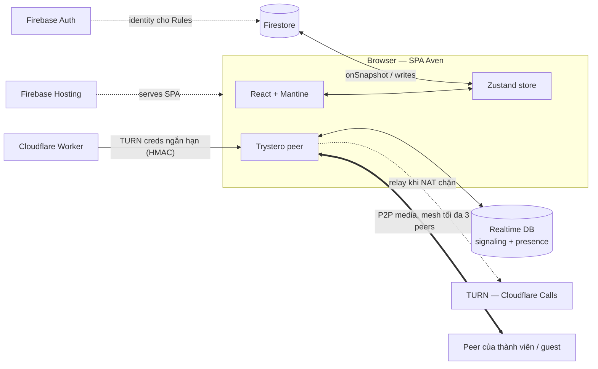

# Aven — Kiến trúc hệ thống

Aven là một SPA quản lý công việc kiểu Kanban, mỗi card là một tài liệu Markdown (live preview kiểu Obsidian), hỗ trợ realtime, chia sẻ bằng link cho guest và gọi video P2P.

Tài liệu này mô tả kiến trúc tổng thể, stack công nghệ, các quyết định thiết kế chính và những hạng mục chủ động trì hoãn.

## Mục lục

1. [Tổng quan kiến trúc](#1-tổng-quan-kiến-trúc)
2. [Stack công nghệ](#2-stack-công-nghệ)
3. [Frontend](#3-frontend)
4. [Markdown pipeline](#4-markdown-pipeline)
5. [Firebase](#5-firebase)
6. [Video call](#6-video-call)
7. [Realtime, presence & offline](#7-realtime-presence--offline)
8. [Quy ước phát triển](#8-quy-ước-phát-triển)
9. [Quyết định đang mở](#9-quyết-định-đang-mở)

---

## 1. Tổng quan kiến trúc

Aven là **SPA thuần client, không có server ứng dụng riêng**. Hệ thống tách thành hai mặt phẳng:

- **App data:** client ↔ Firestore qua `onSnapshot` / write. Realtime là listener của Firestore, không phải WebSocket tự viết.
- **Media:** P2P mesh tối đa 3 peers qua Trystero. Realtime Database (RTDB) chỉ làm signaling; TURN chỉ can thiệp khi NAT chặn kết nối trực tiếp.

> Vì không có backend, **logic phân quyền nằm ở Firestore Security Rules**, còn **bí mật nằm ở Cloudflare Worker**.

## 2. Stack công nghệ

| Lớp | Hạng mục | Công nghệ | Vai trò |
| --- | --- | --- | --- |
| Frontend | Nền tảng | React + Vite + TypeScript | SPA, build, ngôn ngữ duy nhất |
| | UI | Mantine + lucide | Components, hooks, dark mode, bộ icon |
| | Routing | TanStack Router | Route type-safe, view state trên URL |
| | State | Zustand | Client state, nơi `onSnapshot` bơm dữ liệu vào |
| | Markdown render | react-markdown + remark-gfm + remark-frontmatter | Render mọi card ngoài board |
| | Markdown edit | CodeMirror 6 (`@codemirror/lang-markdown`) | Live preview kiểu Obsidian cho card đang mở |
| | Sơ đồ | mermaid | Card chứa khối mermaid là sơ đồ |
| | Drag & drop | `@atlaskit/pragmatic-drag-and-drop` (+ hitbox) | Kanban DnD |
| Backend | Data | Firestore | Toàn bộ dữ liệu ứng dụng |
| | Auth | Firebase Auth | Định danh cho Security Rules |
| | Signaling + presence | Firebase Realtime Database | Bắt tay WebRTC, presence, soft lock |
| | Hosting | Firebase Hosting | Phục vụ SPA, preview channel |
| | Thứ tự card | fractional-indexing | Order key chèn giữa mà không đụng doc khác |
| | Video | Trystero (`@trystero-p2p/firebase`) | Gọi video P2P tối đa 3 peers, message passing |
| | TURN | Cloudflare Worker + Cloudflare Calls TURN | Cấp credential ngắn hạn, relay khi NAT chặn |
| Tooling | Lint / test / format | oxlint / Vitest / oxfmt | Chất lượng code, test logic thuần |

## 3. Frontend

- **React + Vite + TypeScript:** nền SPA, bật strict mode từ đầu. Không dùng Next.js vì không cần SSR; Hosting phục vụ SPA tĩnh là đủ.
- **Mantine:** components + hooks cho mọi UI *trừ* board. Board được tự dựng vì đó là bản sắc của Aven.
- **TanStack Router:** route và search param có kiểu. URL = view state, khớp triết lý "chia sẻ bằng link": refresh, back/forward không làm mất trạng thái.
- **Zustand + `onSnapshot`:** dữ liệu chính là push realtime chứ không phải request/response, nên không dùng TanStack Query. Quy ước: subscription đăng ký theo route, không rải rác trong component sâu.
- **pragmatic-drag-and-drop (+ hitbox):** hạ tầng DnD đang chạy thật trên Trello, nhẹ trên board nhiều card. Đổi lại API thấp cấp, phải tự nối nhiều hơn dnd-kit. dnd-kit bị loại vì đang ở trạng thái bảo trì cá nhân.

## 4. Markdown pipeline

- **Một AST duy nhất (unified/remark):** `react-markdown` + `remark-gfm` + `remark-frontmatter` cho mọi nơi render card; wikilink và backlink cũng chạy trên pipeline này. Một pipeline nghĩa là không chỗ nào "hiểu" Markdown khác nhau.
- **Hai bề mặt:**
  - Card trên board chỉ **render** (rẻ, có thể virtualize).
  - Duy nhất card **đang mở** mới mount CodeMirror 6 live preview kiểu Obsidian (Obsidian cũng chạy CM6). Phần decoration live preview là code tự viết — chi phí lớn nhất của frontend, cần tính ngân sách sớm.
- **Mermaid:** render lazy, `securityLevel: 'strict'` vì guest xem nội dung do người khác viết.
- **Liên kết:** `[[Tên card]]`; nếu trùng tên thì `[[Board/Cột/Tên]]`.
  - Thứ tự resolve: cùng Cột → cùng Board → cùng Space. Còn mơ hồ thì bắt buộc dùng path; không thấy thì là broken link.
  - Markdown lưu **tên, không lưu ID**, nên đổi tên là một rewrite pass qua link index (batch update các card tham chiếu).
  - Backlink được suy ra từ index, không lưu trong DB.
- **Frontmatter:** YAML được parse khi render; nội dung lưu luôn là Markdown nguyên vẹn. Ví dụ `type: video-call` → room = card ID: mở từ board nào cũng vào một call duy nhất, xoá card là hết call.

## 5. Firebase

- **Firestore — tham chiếu bằng ID, không bằng đường dẫn.**
  - Card là document phẳng `spaces/{s}/cards/{c}` mang `columnId` + `orderIndex`; chuyển card = update một doc.
  - Bình luận là subcollection của card nên đi theo card.
  - Column embed = cùng dữ liệu nhìn lại, không copy.
- **fractional-indexing** cho thứ tự: chèn giữa hai key mà không phải viết lại cả cột.
- **Auth + Rules:**
  - Rules là ranh giới quyền duy nhất, chấm theo từng document — nhờ đó quy tắc "không leo thang đặc quyền khi embed" tự động đúng.
  - Guest-link là một document quyền (view / comment / edit, có thể thu hồi hoặc đặt hạn); Rules kiểm tra token của link.
  - Test Rules bằng emulator ngay khi chạm vào quyền guest.
- **RTDB** chỉ làm signaling + presence (có `onDisconnect()` — thứ Firestore không có).
- **Hosting:** SPA fallback + preview channel cho demo.
- **Giới hạn:** không có full-text search (v1 filter phía client, xem [mục 9](#9-quyết-định-đang-mở)); mỗi board một listener, không phải mỗi card một listener.

## 6. Video call

- **Trystero** (`@trystero-p2p/firebase`): WebRTC serverless, mesh peers; message passing để dành cho sau.
- **TURN:** Cloudflare Worker giữ secret HMAC, ký credential ngắn hạn (khoảng 1 giờ) và trả vào `turnConfig`. Client không bao giờ thấy secret.
- **Giới hạn:** quá 3 peers thì phải dùng SFU — đã chốt làm mốc, **không làm ở v1**.

## 7. Realtime, presence & offline

- **End-state sync:** mọi thay đổi board là field update qua `onSnapshot`, lan tới cả guest. Animation kéo card được dựng từ `docChanges()`, không cần event log — chỉ làm event log khi undo/history trở thành feature.
- **Presence:** RTDB `/presence/{spaceId}/{userId}` ghi card đang focus, màu hash từ `uid`; `onDisconnect()` tự dọn khi tab chết.
- **Soft lock:** ai mở editor của card thì presence ghi nhận → người khác thấy màu và chế độ read-only kèm nhãn "A đang sửa". Không dùng CRDT ở v1; Yjs (`y-codemirror.next` + Trystero transport) là phương án nâng cấp ([mục 9](#9-quyết-định-đang-mở)).
- **Offline:** Firestore IndexedDB persistence — ghi offline được xếp hàng và sync khi nối lại; chiến lược là last-write-wins theo trường, không merge. Multi-tab bật `synchronizeTabs: true`. Offline và realtime là một pipeline.

## 8. Quy ước phát triển

- TypeScript strict từ commit đầu; kiểu được chia sẻ giữa `src/` và `worker/`.
- Vitest ưu tiên ba hotspot logic thuần: fractional indexing, resolve link, rename rewrite.
- oxfmt format toàn bộ code (cùng nhà VoidZero với Vite và oxlint).
- E2E thủ công: hai tab + một cửa sổ ẩn danh (đóng vai guest). Dùng Playwright khi cần ([mục 9](#9-quyết-định-đang-mở)).
- **Một repo, hai deploy:**
  - `src/` → Firebase Hosting
  - `worker/` → Cloudflare (wrangler)

## 9. Quyết định đang mở

Các mục dưới đây được chủ động trì hoãn, mỗi mục có điều kiện kích hoạt:

| Quyết định | Điều kiện xem xét lại |
| --- | --- |
| Full-text search (Firestore extension: Algolia/Typesense) | Space lớn tới mức filter client-side bị lag |
| Co-editing CRDT (Yjs + Trystero transport) | Soft lock bị phản ánh là vướng trong thực dùng |
| SFU cho video hơn 3 peers (Cloudflare SFU / LiveKit) | Có nhu cầu gọi nhóm lớn hơn 3 người |
| E2E tự động (Playwright) | Flow guest-link/phân quyền đủ phức tạp để test tay không còn đáng tin |
| Tách trường frontmatter mirror trong Firestore | Cần query theo thuộc tính card từ server |
