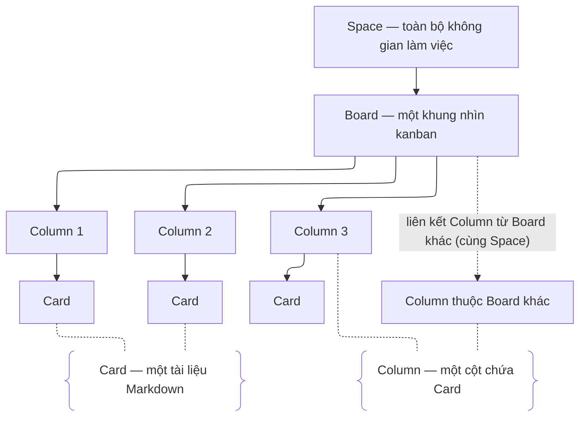

## 1. Định vị

Aven là **không gian làm việc nhẹ (lightweight workspace)** đi cùng công việc, không chỉ là bảng quản lý việc cần làm. Aven lấy mô hình **kanban** làm khung xương — Board, Column, Card — nhưng nâng mỗi Card lên thành một tài liệu đầy đủ: ghi chú, sơ đồ, liên kết, việc cần làm. Nội dung được chia sẻ bằng link và trao đổi ngay trên chính nội dung đó.

- **Đối tượng:** nhóm nhỏ và cá nhân (solo).
- **Tiêu chí thành công:** sau khi bài tập kết thúc, Aven vẫn hữu ích đủ để chính đội phát triển tiếp tục dùng cho công việc cá nhân của mình.

## 2. Cấu trúc: Space → Board → Column → Card

- **Space (không gian làm việc):** ranh giới cao nhất, chứa toàn bộ dữ liệu, thành viên và cấu hình thuộc tính.
- **Board (bảng):** một khung nhìn kanban vào Space — là một *bề mặt nhìn toàn cảnh*, không phải một thư mục cần mở từng trang.
- **Column (cột):** một cột Card đứng cạnh nhau trên Board. Tại mỗi thời điểm, Board hiển thị **toàn bộ Column của nó cùng lúc** — không có thao tác "mở" một Column.
- **Card (thẻ):** đơn vị nội dung nhỏ nhất — một tài liệu Markdown — nằm trong một Column và có thể chuyển giữa các Column.

**Quy tắc liên kết (embed):** có thể hiển thị một Column của Board khác (chỉ trong cùng Space) trên Board hiện tại. Column được liên kết chỉ được *hiển thị lại*, không phải bản sao — nó vẫn là một nguồn dữ liệu duy nhất, nên mọi thao tác (sửa Card, chuyển Card) ở Board nào cũng phản chiếu sang nơi kia.

## 3. Card

Mỗi Card là một tài liệu kiểu **GFM (GitHub-Flavored Markdown)**: hỗ trợ Markdown, code block, Mermaid, liên kết sang Card khác.

- Card chuyên biệt có thêm **thuộc tính** lưu bằng **YAML frontmatter** (dropdown, ngày, người…).
- **Loại Card được nhận diện từ nội dung, không phải enum:** một Card chứa khối Mermaid chính là sơ đồ; một Card nằm trong Column được hiểu là không sửa thường xuyên chính là ghi chú. Riêng **cuộc gọi video** là một loại Card thực sự, được đánh dấu qua frontmatter.
- Danh sách lựa chọn của thuộc tính (ví dụ Trạng thái) được định nghĩa một lần ở cấp Space, dùng chung mọi Card.
- Đổi tên một lựa chọn hoặc một Card thì mọi nơi tham chiếu tự cập nhật (như wikilink của Obsidian). Về mặt kỹ thuật, tham chiếu trỏ tới ID cố định của Card — tên chỉ là lớp hiển thị, nên việc đổi tên không làm gãy link.
- Mỗi Card hiển thị **backlink (liên kết ngược):** những Card đang trỏ tới nó.

## 4. Chia sẻ và quyền

- Thành viên Space có thể được tổ chức thành nhóm với các quyền khác nhau.
- Khách (guest) truy cập qua link mà không cần trở thành thành viên; quyền link gồm xem, bình luận hoặc sửa.
- Chỉ thành viên có quyền quản lý chia sẻ mới được tạo và quản lý link. Mỗi link có URL riêng, có thể thu hồi bất cứ lúc nào hoặc đặt thời hạn tự động hết hiệu lực.
- Có thể giữ Space riêng tư nhưng công khai một Board làm điểm truy cập.
- **Quy tắc liên kết — không leo thang đặc quyền:** nội dung được liên kết vào Board B thì chịu quyền của Board B (Board đang xem), không theo quyền của Board nguồn. Nhờ đó, embed không thể trở thành đường vòng để xem nội dung với quyền rộng hơn mức Board hiện tại cho phép.
- **Trao đổi qua bình luận, kiểu Google Docs:** mỗi Card có một hội thoại hiển thị bên cạnh Card (side panel), không chèn vào nội dung Card. Khách nhìn thấy bình luận; khách có quyền bình luận thì có thể tham gia.

## 5. Tìm kiếm

- **Trong một Space:** tìm kiếm chạy trên toàn Space, quét nội dung của mọi Card.
- **Ngoài Space (cấp trang chủ):** tìm trên tất cả các Space, hoặc vào một Space cụ thể để thu hẹp phạm vi tìm kiếm.