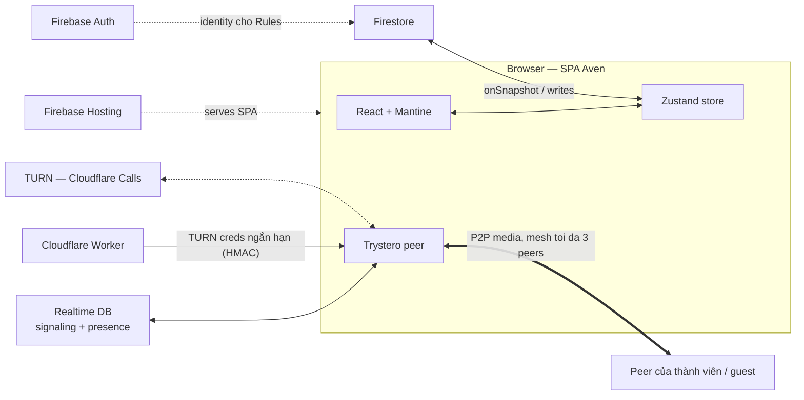

# Aven — Tech Stack

## 1. Kiến trúc

SPA thuần client, không server ứng dụng riêng. Hai mặt phẳng tách bạch:

- **App data:** client ↔ Firestore qua `onSnapshot`/write. Realtime là listener, không phải WebSocket tự viết.
- **Media:** P2P mesh tối đa 3 peers qua Trystero; RTDB chỉ làm signaling; TURN chỉ can thiệp khi NAT chặn.

Vì không có backend, logic quyền sống ở Firestore Security Rules, bí mật sống ở Cloudflare Worker.

## 2. Stack

| Lớp      | <                    | Công nghệ                                        | Vai trò                                       |
| -------- | -------------------- | ------------------------------------------------ | --------------------------------------------- |
| Frontend | Nền tảng             | React + Vite + TypeScript                        | SPA, build, ngôn ngữ duy nhất                 |
| ^        | UI                   | Mantine + lucide                                 | Components, hooks, dark mode, bộ icon         |
| ^        | Routing              | TanStack Router                                  | Route type-safe, view state trên URL          |
| ^        | State                | Zustand                                          | Client state, nơi onSnapshot bơm dữ liệu      |
| ^        | Markdown render      | react-markdown + remark-gfm + remark-frontmatter | Render mọi Card ngoài board                   |
| ^        | Markdown edit        | CodeMirror 6 (`@codemirror/lang-markdown`)       | Live preview kiểu Obsidian cho card đang mở   |
| ^        | Sơ đồ                | mermaid                                          | Card chứa khối mermaid là sơ đồ               |
| ^        | Drag & drop          | @atlaskit/pragmatic-drag-and-drop (+ hitbox)     | Kanban DnD                                    |
| Backend  | Data                 | Firestore                                        | Toàn bộ dữ liệu ứng dụng                      |
| ^        | Auth                 | Firebase Auth                                    | Định danh cho Security Rules                  |
| ^        | Signaling + presence | Firebase Realtime Database                       | Bắt tay WebRTC, presence, soft lock           |
| ^        | Hosting              | Firebase Hosting                                 | Phục vụ SPA, preview channel                  |
| ^        | Thứ tự card          | fractional-indexing                              | Order key chèn giữa mà không đụng doc khác    |
| ^        | Video                | Trystero (`@trystero-p2p/firebase`)              | Gọi video P2P tối đa 3 peers, message passing |
| ^        | TURN                 | Cloudflare Worker + Cloudflare Calls TURN        | Cấp credential ngắn hạn, relay khi NAT chặn   |
| Tooling  | Lint / test / format | oxlint / Vitest / oxfmt                          | Chất lượng code, test logic thuần             |

## 3. Frontend

- **React + Vite + TypeScript** — nền SPA, strict mode từ đầu. Không Next.js: không cần SSR, Hosting phục vụ SPA tĩnh là đủ.
- **Mantine** — components + hooks cho mọi UI *trừ* board: board tự dựng, là bản sắc của Aven.
- **TanStack Router** — route và search param có kiểu. URL = view state, khớp triết lý "chia sẻ bằng link": refresh, back/forward không mất trạng thái.
- **Zustand + onSnapshot** — dữ liệu chính là push realtime, không phải request/response, nên không dùng TanStack Query. Quy ước: subscription đăng ký theo route, không rải rác trong component sâu.
- **pragmatic-drag-and-drop (+ hitbox)** — hạ tầng DnD đang chạy thật trên Trello, nhẹ trên board nhiều card. Đổi lại API thấp cấp, tự nối nhiều hơn dnd-kit; dnd-kit loại vì đang ở trạng thái bảo trì cá nhân.

## 4. Markdown pipeline

- **Một AST duy nhất (unified/remark):** react-markdown + remark-gfm + remark-frontmatter cho mọi nơi render card; wikilink và backlink cũng chạy trên pipeline này. Một pipeline = không chỗ nào "hiểu" markdown khác nhau.
- **Hai bề mặt:** card trên board chỉ render (rẻ, virtualizable); duy nhất card đang mở mount CodeMirror 6 live preview kiểu Obsidian — Obsidian cũng chạy CM6. Live preview decoration là phần tự viết: chi phí lớn nhất của frontend, tính ngân sách sớm.
- **Mermaid:** render lazy, `securityLevel: 'strict'` — guest xem nội dung người khác viết.
- **Liên kết:** `[[Tên card]]`, trùng tên thì `[[Board/Cột/Tên]]`. Thứ tự resolve: cùng Cột → cùng Board → cùng Space; còn mơ hồ thì bắt buộc path; không thấy thì broken link. Markdown lưu tên, không lưu ID — đổi tên là một rewrite pass qua link index (batch update các card tham chiếu). Backlink suy từ index, không lưu DB.
- **Frontmatter:** YAML parse khi render, nội dung lưu luôn là markdown nguyên vẹn. `type: video-call` → room = card ID: mở từ board nào cũng một call, xoá card là hết call.

## 5. Firebase

- **Firestore — tham chiếu bằng ID, không đường dẫn.** Card là doc phẳng `spaces/{s}/cards/{c}` mang `columnId` + `orderIndex`; chuyển card = update một doc. Bình luận là subcollection của card nên đi theo card. Column embed = cùng dữ liệu nhìn lại, không copy.
- **fractional-indexing** cho thứ tự: chèn giữa hai key mà không viết lại cả cột.
- **Auth + Rules:** Rules là ranh giới quyền duy nhất, chấm theo document — nhờ vậy quy tắc "không leo thang đặc quyền khi embed" của spec tự động đúng. Guest-link là document quyền (view/comment/edit, thu hồi hoặc đặt hạn được); Rules kiểm tra token của link. Test rules bằng emulator ngay khi chạm vào quyền guest.
- **RTDB** chỉ làm signaling + presence (có `onDisconnect()` — thứ Firestore không có).
- **Hosting:** SPA fallback + preview channel cho demo.
- Giới hạn: không full-text search — v1 filter client-side (mục 9); một listener mỗi board, không mỗi card.

## 6. Video call

Trystero (`@trystero-p2p/firebase`): WebRTC serverless, mesh peers, message passing để dành cho sau. TURN: Cloudflare Worker giữ secret HMAC, ký credential ngắn hạn (khoảng 1 giờ) trả vào `turnConfig` — client không bao giờ thấy secret. Quá 3 peers thì phải SFU — chốt mốc, không làm v1.

## 7. Realtime, presence & offline

- **End-state sync:** mọi thay đổi board là field update qua `onSnapshot`, lan tới cả guest. Animation kéo card dựng từ `docChanges()`, không cần event log — chỉ làm khi undo/history thành feature.
- **Presence:** RTDB `/presence/{spaceId}/{userId}` — card đang focus, màu hash từ uid, `onDisconnect()` tự dọn khi tab chết.
- **Soft lock:** ai mở editor của card thì presence ghi nhận → người khác thấy màu + read-only kèm nhãn "A đang sửa". Không CRDT ở v1: Yjs (y-codemirror.next + Trystero transport) là phương án nâng cấp, mục 9.
- **Offline:** Firestore IndexedDB persistence — ghi offline xếp hàng, sync khi nối lại; là last-write-wins theo trường, không merge. Multi-tab bật `synchronizeTabs: true`. Offline và realtime là một pipeline.

## 8. Quy ước phát triển

- TypeScript strict từ commit đầu; kiểu chia sẻ giữa `src/` và `worker/`.
- Vitest ưu tiên ba hotspot logic thuần: fractional indexing, resolve link, rename rewrite.
- oxfmt format toàn bộ code (cùng nhà VoidZero với Vite, oxlint).
- E2E thủ công: hai tab + một cửa sổ ẩn danh (đóng vai guest). Playwright khi cần (mục 9).
- Một repo, hai deploy: `src/` → Firebase Hosting, `worker/` → Cloudflare (wrangler).

## 9. Quyết định đang mở

Chủ động trì hoãn. Mỗi mục có điều kiện kích hoạt:

| Quyết định | Điều kiện xem xét lại |
|---|---|
| Full-text search (Firestore extension: Algolia/Typesense) | Space lớn tới mức filter client-side lag |
| Co-editing CRDT (Yjs + Trystero transport) | Soft lock bị phản ánh là vướng trong thực dùng |
| SFU cho video hơn 3 peers (Cloudflare SFU / LiveKit) | Có nhu cầu gọi nhóm lớn hơn 3 |
| E2E tự động (Playwright) | Flow guest-link/phân quyền đủ phức tạp để test tay không đáng tin |
| Tách trường frontmatter mirror trong Firestore | Cần query theo thuộc tính card từ server |
